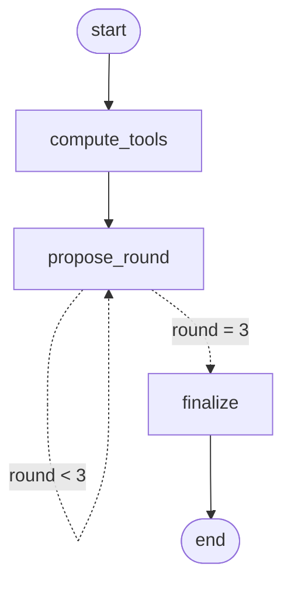

# Agentic LLMs for Supply Chain Optimization

An autonomous multi-agent simulation framework designed to mitigate the **Bullwhip Effect** and optimize decentralized inventory management using Large Language Models (LLMs). This project simulates a 3-echelon supply chain and utilizes **LangGraph** to orchestrate dynamic, multi-round negotiations between autonomous AI agents powered by **Google Gemini 2.5 Flash** (via Vertex AI).

## 🚀 Key Results
- **80.3% Reduction in the Bullwhip Effect** (Variance amplification decreased from 84.02 to 16.57).
- **29.9% Minimization of Cumulative Operational Costs** compared to isolated baseline algorithms.
- Successfully demonstrated that emergent stabilization and variance reduction can be achieved intrinsically through multi-agent negotiation, without centralized control.

## 🛠️ Tech Stack
- **Python 3.x**
- **Google Vertex AI API** (Gemini 2.5 Flash)
- **LangGraph** (State machine orchestration for cyclical negotiations)
- **Merton Jump Diffusion (MJD)** (Stochastic demand generation)
- **Regex** (Safe parsing of non-deterministic LLM text outputs)

## 🏗️ System Architecture
The project evaluates 5 progressively sophisticated LLM-based consensus-seeking frameworks:

1. **F1 (Standalone LLM):** Agents decide independently based solely on local observations (inventory, backlog, pipeline). No inter-agent communication.
2. **F2 (Information Sharing):** Agents receive a natural-language summary of their immediate neighbors' states alongside an inventory-position anchor.
3. **F3 (Standalone + Tools):** No communication, but agents utilize a unified dual-tool architecture (Demand Forecast and Economic Order Quantity (EOQ)) injected into the prompt as advisory signals.
4. **F4 (Information Sharing + Tools):** Combines F2 and F3. Agents reason about their own state, neighbor states, and mathematical tool suggestions simultaneously.
5. **F5 (Negotiation + Tools):** Neighboring agents engage in a bilateral, 3-round negotiation state machine managed by LangGraph before committing to a final order, forcing mutual consistency and preventing extreme demand spikes.

## ⚙️ How It Works (F5 Negotiation Protocol)
Each simulation step, F5 invokes a compiled **LangGraph `StateGraph`** (`build_negotiation_graph` in `run_f5.py`). The graph state holds every agent's observation, tool outputs, current proposals and a round counter; a conditional edge loops the `propose_round` node until `num_iter = 3` rounds are done:



- **compute_tools:** runs the Demand Forecast and EOQ tools once per agent.
- **propose_round:** one negotiation round; the three agents call Gemini in parallel, each seeing its neighbours' previous-round proposals.
- **finalize:** applies the EOQ safety floor and returns the committed orders.

Inside the loop, the rounds work as follows:
- **Round 1 (Initiation):** Agents propose an order based on their tool anchor. The demand forecast acts as a hard minimum floor.
- **Round 2 (Response):** Agents receive neighbor proposals. The system programmatically extracts these numerical values via Regex and calculates a midpoint guidance value to encourage convergence.
- **Round 3 (Final Decision):** Final convergence. Proposals become committed orders, explicitly discouraging erratic spikes and smoothing the supply chain.

## 🏃‍♂️ Running the Simulation
Ensure you have your Google Vertex AI credentials configured in a `.env` file.

To run the standalone baseline (F1):
```bash
python run_f1.py
```

To run the full multi-round negotiation framework (F5):
```bash
python run_f5.py --rounds 3
```

To check the LangGraph negotiation without any API calls (a deterministic fake model; verifies the graph's structure, round count, and that a full 200-step run matches the original round-loop implementation order-for-order):
```bash
python test_f5_graph.py
```

*This project was developed as part of a Bachelor Thesis Project (BTP).*
